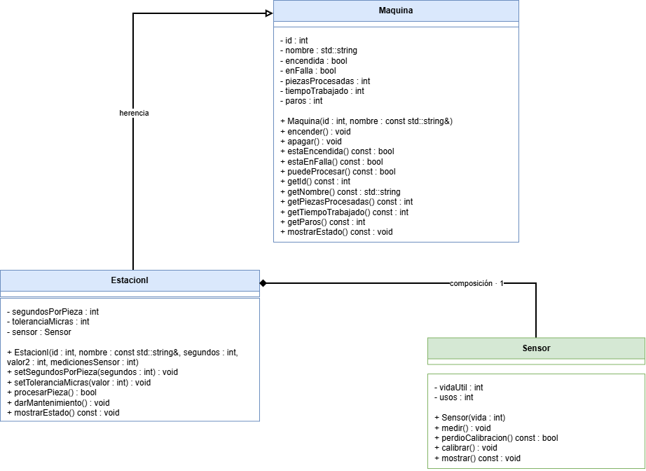

# Propuesta de mejora: Acciones preventivas a fallas sobre el desgaste

**Propuesta de mejora elaborada por:** Michelle González Barrera
## 1. Impacto

**¿Es una mejora o una corrección?**

Esta propuesta se podría considerar más que nada una corrección

**¿Qué observaste en la solución del equipo que dio origen a la propuesta?**

En nuestra solución se puede observar que la "producción" falla al momento que el componente de la maquina ya no funciona porque su vida util ha terminado y no se arregla o no se le da mantenimiento hasta previo a la siguiente pieza. Propongo una pequeña alteración a este mantenimiento, que se le de mantenimiento inmediatamente después de la última pieza que en la que se haya operado. Otra manera de corregir esto, pero que realmente sería bastante similar a la solución aplicada, sería que al tener definido una vida util de cada pieza, darle mantenimiento previo a su ultimo uso, para prevenir un paro por falla y evitar que las piezas salgan defectuosas.

**¿Qué mejora o qué corrige, y por qué vale la pena?**

Como se mencionó en la respuesta anterior, esto podría permitir una agilidad en la producción y la prevención de productos o piezas defectuosas.

## 2. Qué implica

**Clases nuevas:**

No se requerirían clases nuevas

**Comportamiento nuevo en clases existentes:**

En el Sensor se debe agregar un método de consulta (por ejemplo, bool estaEnRiesgoFalla() o bool necesitaMantenimiento()) que indique si las mediciones restantes son iguales a 1 o han llegado al umbral crítico antes de agotarse.
En la EstacionI habría que hacerse una modificación del flujo en procesarPieza() Antes de procesar o inmediatamente después de registrar la medición, la estación evalúa la vida útil restante del sensor.
Se tendría que aplicar lo que se le llama lógica preventiva/inmediata, o sea que, si detecta que la pieza actual consumió la última medición del sensor, invoca de forma automática a darMantenimiento() al finalizar el procesamiento de esa pieza, en lugar de esperar al inicio del siguiente ciclo o a que el sistema falle.

**Interacciones nuevas entre objetos:**

Consulta preventiva antes/después del procesamiento: Durante la ejecución de procesarPieza(), la instancia de EstacionI interactúa con su atributo sensor consultando su estado de desgaste activo mediante sus nuevos métodos de inspección.

Autoinvocación de mantenimiento: Si la condición se cumple, EstacionI ejecuta this->darMantenimiento(), lo que a su vez restablece los contadores internos del sensor inmediatamente después de procesar la pieza, evitando que la máquina pase por un estado de falla (falla = true).

**Relaciones nuevas (herencia, composición o agregación) y por qué son de ese tipo:**

No aplica

## 3. Diagrama de clases

Diagrama hecho en draw.io que muestre la solución con la mejora incorporada. Distingue lo nuevo de lo existente, por ejemplo con otro color. Guarda la imagen en esta misma carpeta y enlázala aquí.

