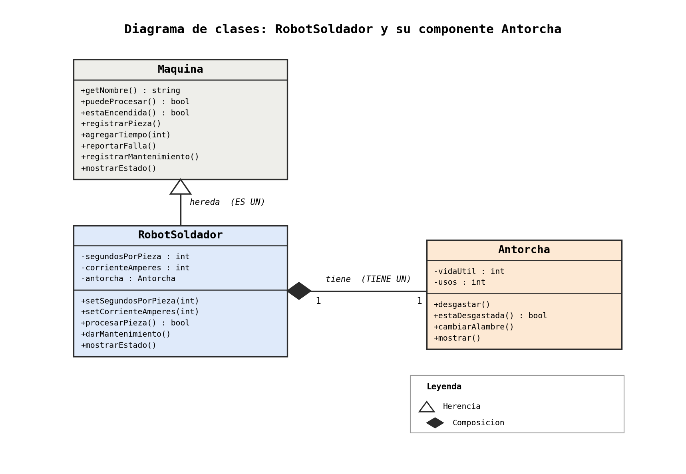

**Elaborada por:** [BRAYAN LOPEZ]
**Matrícula:** [25160]
**Bloque:** [3]

## 1. Propósito

**¿Qué máquina representa tu clase y qué operación hace sobre la pieza?**

RobotSoldador representa una estación de soldadura automatizada. Su método procesarPieza() realiza la soldadura de una pieza individual, suma el tiempo de operación (agregarTiempo()) y registra el avance en la base (registrarPieza()). Solo opera si la máquina está encendida y libre de fallas; de lo contrario, rechaza la pieza y devuelve false. Además, gestiona la corriente de soldadura (corrienteAmperes).

**¿Cuál es su componente y por qué no existe sin la máquina?**

El componente es la Antorcha (con su alambre de soldar). Se desgasta con cada pieza procesada y, al agotar su vida útil, manda al robot a estado de falla.

Su relación es de composición (RobotSoldador ◆— Antorcha) porque:

Es un objeto miembro directo (no un puntero); se instancia en la lista de inicialización del constructor del robot y se destruye junto con él.

Su ciclo de vida, uso (desgastar()), consulta (estaDesgastada()) y reemplazo (cambiarAlambre()) son administrados exclusivamente por el robot.

## 2. Decisiones de diseño

**Atributos propios de tu clase y validación de cada uno:**

RobotSoldador:

segundosPorPieza (int): Debe ser > 0. Validador: setSegundosPorPieza(). Valor por defecto: 20.

corrienteAmperes (int): Debe ser > 0. Validador: setCorrienteAmperes(). Valor por defecto: 200.

antorcha (Antorcha): Componente interno.

Antorcha:

vidaUtil (int): Debe ser > 0. Si se ingresa un valor inválido en el constructor, se asigna 15 por defecto.

usos (int): Inicia en 0. Se incrementa con desgastar() y vuelve a 0 con cambiarAlambre().

Estrategia de validación: El constructor asigna valores por defecto válidos y luego llama a los setters para procesar los argumentos recibidos. Si se recibe un dato inválido, se conserva el valor por defecto.

**Métodos propios (los que la clase base no tiene):**

`RoboRobotSoldador:

setSegundosPorPieza(int) / setCorrienteAmperes(int): Asignan atributos previa validación (> 0).

procesarPieza(): Si la máquina está disponible, descuenta vida a la antorcha, registra el trabajo y, si la antorcha llega a su límite, reporta la falla.

darMantenimiento(): Restablece la antorcha (cambiarAlambre()) y remueve el estado de falla invocando registrarMantenimiento().

Antorcha:

desgastar(): Incrementa el contador usos.

estaDesgastada(): Devuelve true si usos >= vidaUtil.

cambiarAlambre(): Reinicia usos a 0.

mostrar(): Imprime el desgaste actual vs. la vida útil.

**Método de la base que redefines, y cómo reutilizas la versión de la base:**
Redefino `mostrarEstado() const`. Lo primero que hace es llamar a `Maquina::mostrarEstado()` para que la base imprima lo que ya sabe mostrar de toda máquina. Después agrega lo propio del robot: la corriente en amperes, los segundos por pieza y, delegando en `antorcha.mostrar()`, el desgaste de la antorcha.

Con esto no repito código de la base, y si la base cambia su forma de mostrar el estado, mi clase lo hereda automáticamente.

**¿Cómo modelaste el desgaste del componente y por qué así?**

Se modeló contando piezas procesadas (usos vs vidaUtil).

Cada pieza soldada ejecuta antorcha.desgastar().

Se evalúa usos >= vidaUtil para determinar el desgaste.

La pieza que agota la antorcha se termina de soldar con éxito. La falla se notifica al terminar, haciendo que la siguiente pieza sea la rechazada.

darMantenimiento() reinicia usos a 0 sin modificar la vidaUtil.

**Elegí este modelo por estas razones:**

- **La unidad es la pieza.** Es lo que la máquina procesa, así que medir el desgaste en piezas no requiere conversiones ni cálculos de tiempo.
- **Es simple y predecible.** Cada pieza gasta exactamente 1, lo que lo hace fácil de probar: con vida 3, la tercera pieza provoca la falla.
- **Está encapsulado.** La antorcha es dueña de su estado y la regla de cuándo está desgastada vive en un solo lugar. El robot solo pregunta `estaDesgastada()` y decide qué hacer con la respuesta.
- **La pieza que agota la antorcha sí se suelda.** La falla se reporta después de procesarla, así que la primera pieza rechazada es la siguiente.

**¿Qué usa tu clase de `Maquina` y qué agrega?**

Reutiliza: Constructor base, getters (getNombre()), estados (estaEncendida(), puedeProcesar()), contadores (registrarPieza(), agregarTiempo()), manejo de paros (reportarFalla(), registrarMantenimiento()) y mostrarEstado().

Agrega: La Antorcha como componente, parámetros específicos (amperaje y tiempo/pieza) y la lógica de paro por desgaste.

## 3. Diagrama

Diagrama de tu clase y su componente, hecho en draw.io. Debe mostrar la relación de herencia con `Maquina` y la de composición con tu componente. Guarda la imagen en `docs/` y enlázala aquí.

 
## 4. Bitácora

**Dudas que tuviste y cómo las resolviste:**

¿Puntero o valor para la antorcha? Se definió como objeto por valor para garantizar la composición pura: no requiere new/delete y su ciclo de vida queda ligado automáticamente al robot.

¿Reutilización de mostrarEstado()? Se resolvió invocando de manera explícita Maquina::mostrarEstado() al inicio del método redefinido.

¿Momento del reporte de falla? Se determinó reportarla al finalizar el procesamiento de la pieza para evitar dejar un trabajo a medias.

**Errores que encontraste y cómo los corregiste:**

Error de compilación por falta de constructor por defecto en Antorcha: Se solucionó usando la lista de inicialización del constructor de RobotSoldador (antorcha(vidaAntorcha)).

Paro persistente tras mantenimiento: darMantenimiento() reiniciaba el contador de la antorcha pero omitía notificar a la base. Se corrigió agregando la llamada a registrarMantenimiento().