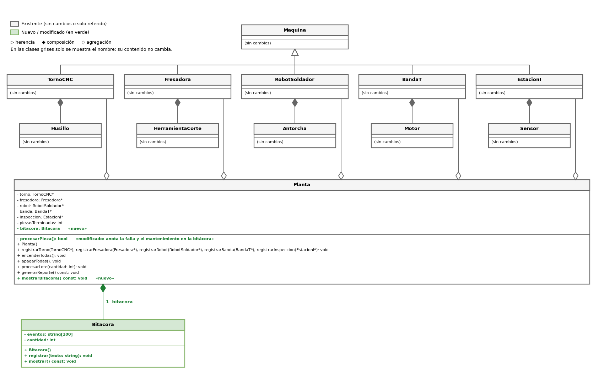

# Propuesta de mejora: [Inserta aquí el título de tu propuesta]

> Crea una carpeta dentro de `docs/mejoras/` con tu número de matrícula como nombre, copia este archivo ahí como `mejora.md` y llena tu copia. No modifiques la plantilla.
>
> La propuesta es solo diseño: no se programa.

**Propuesta de mejora elaborada por:** [brayan lopez]

## 1. Impacto

**¿Es una mejora o una corrección?**
[Es una mejora. Actualmente la planta cumple con procesar la producción, pero carece de un historial o memoria de lo que ocurre paso a paso durante el turno.]

**¿Qué observaste en la solución del equipo que dio origen a la propuesta?**

[Al revisar el reporte final que genera el sistema, noté que solo entrega totales acumulados por máquina. No indica en qué pieza ocurrió una falla ni cuándo se le dio mantenimiento. Esos detalles sí suceden durante la corrida, pero se imprimen directo a la consola como mensajes sueltos y se pierden, ya que la clase Planta no guarda un historial.

El caso más crítico es el de la banda transportadora: en nuestra solución traslada la pieza entre cada estación (3 traslados por pieza). Para un lote de 20 piezas se generan más de 150 líneas de salida en la consola. Al final, el reporte se limita a mostrar algo como "Banda transportadora: 60 piezas, 1 paro", sin aclarar que la falla ocurrió en el traslado 50 (a mitad de la pieza 17, entre la fresadora y el robot). Si queremos comprobar nuestros cálculos manuales, nos toca revisar línea por línea a ojo entre todo el texto de la pantalla.]

**¿Qué mejora o qué corrige, y por qué vale la pena?**

[La propuesta es dotar a la planta de una bitácora de turno: un registro cronológico de eventos de falla y mantenimiento que se imprime estructurado al final del reporte.

Ejemplo de cómo se visualizaría la salida:

Plaintext
=== Bitácora del turno ===
Pieza 9: falla Torno CNC
Pieza 10: mantenimiento Torno CNC
Pieza 15: falla Robot soldador
Pieza 16: mantenimiento Robot soldador
Pieza 17: falla Banda transportadora
Pieza 17: mantenimiento Banda transportadora
Pieza 18: falla Torno CNC
Pieza 19: mantenimiento Torno CNC

Vale la pena por tres razones:

Validación rápida: Permite comparar los cálculos hechos a mano directamente contra la lista de eventos, en lugar de rastrearlos entre cientos de líneas de consola.

Contexto completo: Explicita el porqué y el cuándo de los paros, no solo el conteo total.

Claridad operacional: Despeja dudas en casos como el de la banda transportadora, donde los "60 eventos" representan en realidad 60 traslados individuales de las 20 piezas del lote.]

## 2. Qué implica

**Clases nuevas:**

Bitacora: Manejará un arreglo de cadenas (string eventos[100]) para almacenar los mensajes y un entero cantidad como contador. Incluirá los métodos registrar(string texto) (valida espacio antes de insertar) y mostrar() (imprime el historial ordenado). 

**Comportamiento nuevo en clases existentes:**

Planta: Tendrá un atributo de tipo Bitacora. Dentro de procesarPieza(), cada vez que identifique un fallo o mantenimiento en una máquina, registrará el evento indicando el número de pieza actual (piezasTerminadas + 1). Se agregará el método mostrarBitacora(), llamado al cierre de generarReporte().

Maquina y subclases: Permanecen sin cambios.

**Interacciones nuevas entre objetos:**

Planta → Bitacora: La planta llamará a bitacora.registrar(...) cada vez que ocurra una incidencia. La planta obtendrá el nombre del equipo involucrado mediante getNombre() para armar la descripción del evento.

**Relaciones nuevas (herencia, composición o agregación) y por qué son de ese tipo:**

Composición (Planta ◆— Bitacora): La bitácora le pertenece únicamente al turno de la planta: se crea con ella y se destruye con ella. No es agregación porque no se recibe desde main como las máquinas, sino que la planta es su propietaria exclusiva.

Sin herencia nueva: Bitacora es una clase concreta independiente.

Sin cambios con respecto a las máquinas: La bitácora solo guarda texto, no punteros a los objetos de tipo Maquina. La agregación previa entre Planta y Maquina se conserva intacta.

## 3. Diagrama de clases

Diagrama hecho en draw.io que muestre la solución con la mejora incorporada. Distingue lo nuevo de lo existente, por ejemplo con otro color. Guarda la imagen en esta misma carpeta y enlázala aquí.

